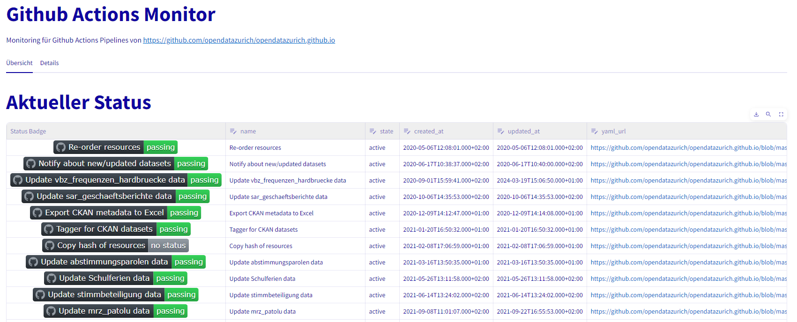
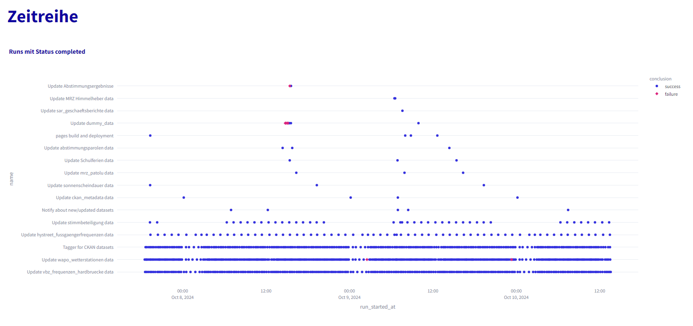
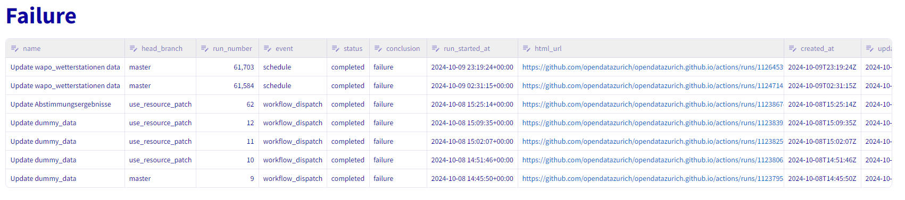
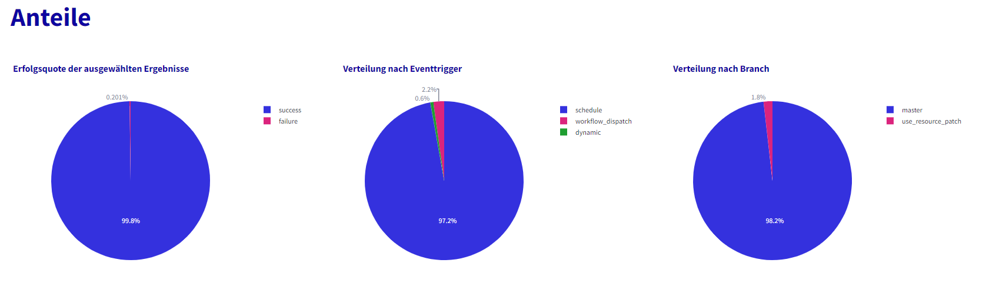

# GitHub Actions Monitor

[](LICENSE)
[](pyproject.toml)
[](https://github.com/opendatazurich/github_actions_monitor/actions/workflows/tests.yml)

A small Streamlit app to monitor the GitHub Actions workflows of a repository. Built on the [GitHub REST API for workflow runs](https://docs.github.com/en/rest/actions/workflow-runs?apiVersion=2022-11-28).

The UI is in German, but the code and this README are in English — the app was built for a German-speaking audience, but should be straightforward to reuse elsewhere.

## Features

- Overview of all workflows with their current status badges
- Time series of runs by started-at, colored by conclusion
- Distribution of runs by conclusion, trigger event, and head branch
- Mean run duration per workflow
- Table of currently running (non-completed) runs
- Table of failed runs
- Full data table of all fetched runs

## Screenshots









## Setup

**Prerequisites:** Python 3.11+ and [uv](https://docs.astral.sh/uv/).

```bash
uv sync
cp .streamlit/secrets.toml.example .streamlit/secrets.toml
# edit .streamlit/secrets.toml and fill in ACCESS_TOKEN and REPO
uv run streamlit run actions_monitor.py
```

## Configuration

Secrets are read from `.streamlit/secrets.toml` (see [Streamlit docs](https://docs.streamlit.io/deploy/streamlit-community-cloud/deploy-your-app/secrets-management)):

| Key | Required | Description |
|-----|----------|-------------|
| `ACCESS_TOKEN` | yes | GitHub personal access token (see below) |
| `REPO` | yes | `OWNER/REPO` of the repository to monitor |

Example: `REPO = "opendatazurich/opendatazurich.github.io"`.

## GitHub token

Create a [personal access token](https://docs.github.com/en/authentication/keeping-your-account-and-data-secure/managing-your-personal-access-tokens) with the following scopes:

- **Fine-grained PAT (recommended):** `Actions: Read-only` + `Metadata: Read-only`, scoped to the target repository.
- **Classic PAT:** `repo` scope for private repositories; no scope needed for public repositories (but the unauthenticated rate limit is much lower, so a token is still recommended).

## Deployment

The app runs on [Streamlit Community Cloud](https://streamlit.io/cloud) out of the box — connect the repository and set `ACCESS_TOKEN` and `REPO` via the Secrets UI. Running in Docker is possible but out of scope for this README.

## Limitations

- The authenticated GitHub REST API rate limit is 5000 requests/hour. The "Anzahl Ergebnisse" slider in the UI controls how many runs are fetched — higher values mean more API calls and slower loads.
- API responses are cached in-process for 5 minutes (`@st.cache_data(ttl=300)`); restart the app or wait out the TTL to force a refresh.

## Public vs private repositories

Public repositories work with reduced token scopes (classic PAT without `repo`, or no token at all with sharply reduced rate limits). Private repositories require a token with read access.

## Development

```bash
uv sync          # install dependencies (incl. dev group)
uv run pytest    # run the test suite
uv run ruff check .   # lint
```

CI runs the same lint + test commands on push/PR across Python 3.11–3.14.

## Contributing

Contributions are welcome! Feel free to open an issue to discuss ideas or send a pull request directly — bug fixes, new features, UI improvements, or documentation tweaks are all appreciated. Please make sure tests and lint pass locally (`uv run pytest`, `uv run ruff check .`) before submitting.

## License

[MIT](LICENSE) — © 2026 Open Data Zürich.
